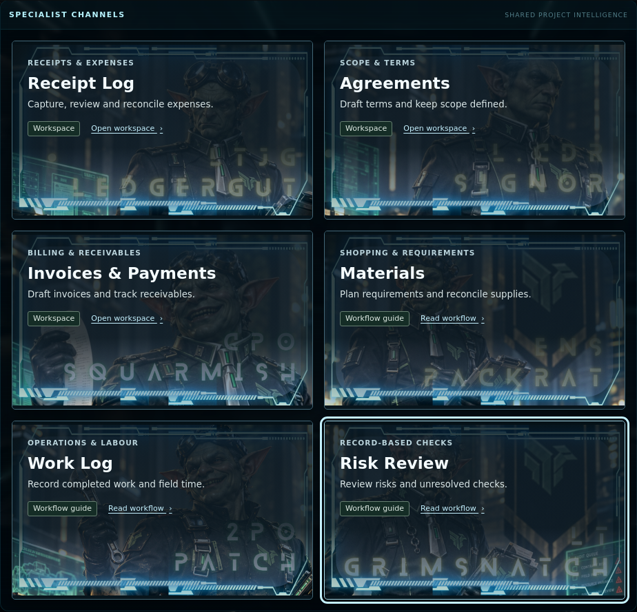

# Static specialist pane integration — 2026-10-15

The Command Desk and project workbench now mount the six supplied original panes, rather than the low-resolution beta portrait strip. A shared catalogue and panel macro keep role labels, display identities, and artwork consistent. The actual business records, counts and destinations remain independent HTML; no image is used as a functional screenshot.

## Canon and behavior

- Preserve all six original 1536 × 877 PNGs byte-for-byte. Contain their full frames without cropping or stretching. Load images lazily and reserve panel layout independently of them.
- Keep business functions primary. The artwork already contains rank/name engravings; accessible HTML describes the matching identity without printing another name over the image.
- Use the supplied ranks: LTJG Ledgergut, L.CDR SigNor, CPO Squarmish, ENS Packrat, 2PO Patch, LT Grimsnatch. Public Grimsnatch text is consistent; legacy internal IDs/routes remain unchanged.
- Treat cyan panes as Æterna's projection over the physical green-steel workforce. No uniforms or insignia were regenerated or recolored.
- Distinguish desk workspaces from workflow guides. Project cards show scoped record counts and link to existing records or advisory checks; no new specialist capability or clearance is implied.
- No new specialist animation, speech, autoplay media, or autonomous action.

## Verification

- Full Python suite: **204 passed**. New checks cover shared identities/art, actual project and business scope, singular/plural counts, project destinations, exact PNG bytes, image decoding, MIME type, and conditional cache revalidation.
- Targeted Chromium checks: **all passed** on both the desk and a real project at 1440, 1024, 768, 390, and 320px. Tested full art decoding, content bounds, horizontal overflow, native links, keyboard focus, accessible names/descriptions, and absence of specialist media/animation.
- Automated WCAG A/AA checks with axe-core on desktop and phone project panes: **no violations** in the specialist section. This is scoped automated evidence, not a certification of the entire application.
- Additional browser cases passed: 200% text, removed decorative layers with unchanged content geometry, failed image requests, forced colors, and reduced transparency with readable text identities.
- Screenshots were inspected on desktop, phone, large text, forced colors and reduced transparency. Enlarged text exposed a clipping defect during development; the cards now grow with their HTML content.
- All non-film sections of the existing browser smoke passed on desktop and phone in a temporary local run excluding only film checks. The smoke now waits for form navigation explicitly to avoid false failures on same-route submissions.
- Full original browser smoke has a local limitation: the available Chromium headless shell cannot decode the existing H.264 startup/intro films. The committed smoke retains those checks; no production film behavior or CI coverage was disabled.

Run `pytest -q`, `node tests/specialist_panels.mjs`, and `node tests/ui_smoke.mjs` against a local test server. The browser suite requires Playwright/Chromium and axe-core. An optional `GBO_BROWSER_EXECUTABLE` selects an existing browser binary. Browser tests create disposable QA client/project records and should target a test instance.

This change is prepared for review on the implementation branch. It has not been merged, deployed, or verified against the live authenticated application.
